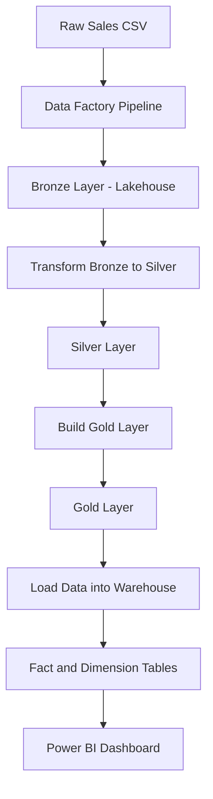
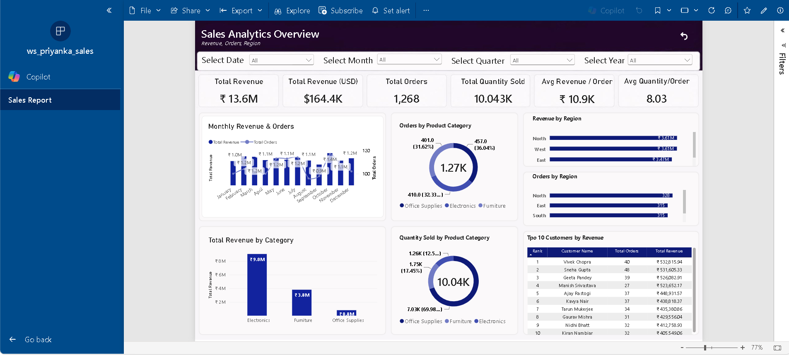
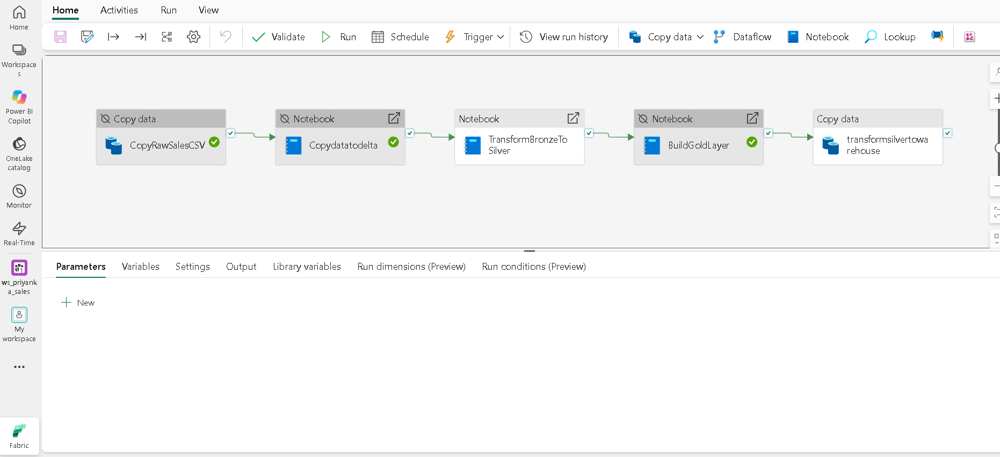
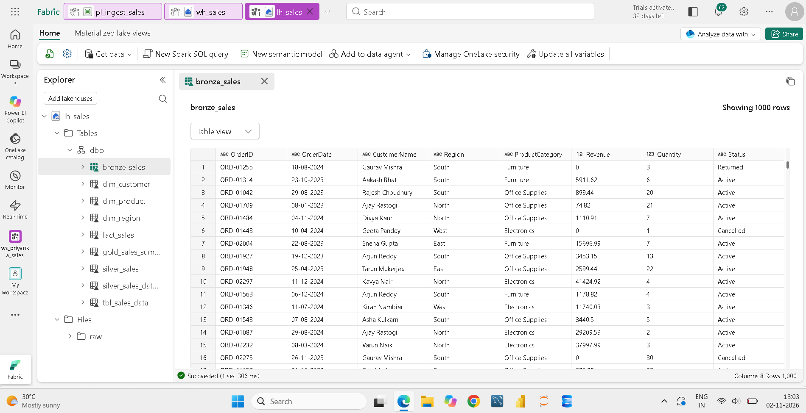
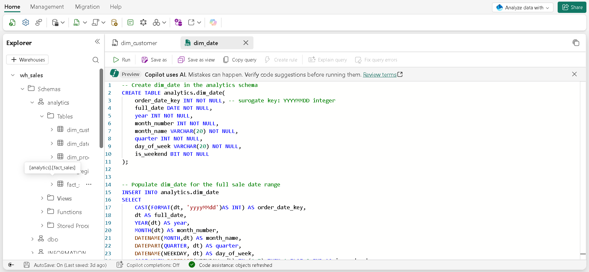

# Microsoft Fabric – End-to-End Sales Analytics Project

## 📌 Project Overview

This project demonstrates an end-to-end sales analytics solution developed using Microsoft Fabric and Power BI.

The main objective is to build a complete data analytics workflow, starting from raw sales data ingestion to data transformation, data warehousing and interactive dashboard development.

The project follows the **Medallion Architecture (Bronze, Silver and Gold)** to organize and prepare data for business analysis.

## 🛠️ Tools & Technologies

- Microsoft Fabric
- Data Factory Pipeline
- Fabric Lakehouse
- Fabric Notebooks
- PySpark
- Medallion Architecture
- Fabric Data Warehouse
- SQL
- Power BI Desktop

## 🏗️ Project Architecture

The project follows this data processing workflow:

**Raw Sales CSV → Data Ingestion → Bronze Layer → Silver Layer → Gold Layer → Fabric Warehouse → Power BI Dashboard**

### Architecture Diagram

## ⚙️ Project Workflow

### 1. Data Ingestion

- Imported raw sales CSV data into Microsoft Fabric.
- Created a Data Factory pipeline to manage the ingestion workflow.
- Used Copy Data and Notebook activities to process the data.

### 2. Data Transformation – Medallion Architecture

**Bronze Layer**
- Stores the ingested raw sales data in the Lakehouse.

**Silver Layer**
- Transforms and prepares the Bronze data for further analysis.
- Uses Fabric Notebooks for data processing.

**Gold Layer**
- Creates analytics-ready data for reporting and business analysis.

### 3. Data Warehousing

- Loaded transformed data into Microsoft Fabric Warehouse.
- Created dimension tables for Customer, Product, Region and Date.
- Created a Fact Sales table to support analytical reporting.
- Used SQL for table creation and data modelling.

### 4. Power BI Dashboard Development

Developed an interactive Sales Analytics Dashboard using Power BI Desktop.

**Key Performance Indicators (KPIs):**
- Total Revenue
- Total Revenue (USD)
- Total Orders
- Total Quantity Sold
- Average Revenue per Order
- Average Quantity per Order

**Dashboard Visualizations:**
- Monthly Revenue and Orders
- Orders by Product Category
- Revenue by Region
- Orders by Region
- Total Revenue by Category
- Quantity Sold by Product Category
- Top 10 Customers by Revenue

**Interactive Filters:**
- Date
- Month
- Quarter
- Year

## 📊 Dashboard Preview

## 🔄 Data Pipeline

The following pipeline activities were used to orchestrate the workflow:

1. CopyRawSalesCSV
2. Copydatatodelta
3. TransformBronzeToSilver
4. BuildGoldLayer
5. transformsilvertowarehouse

## 🗄️ Lakehouse Preview

The Bronze sales table is stored in the Microsoft Fabric Lakehouse.

## 🧮 Warehouse and SQL

Created and organized analytical tables under the `analytics` schema in the Fabric Warehouse.

The data model includes:

- dim_customer
- dim_date
- dim_product
- dim_region
- fact_sales

Created the Date Dimension using SQL to support time-based analysis.

## 💡 Business Analysis Objectives

This dashboard helps answer important business questions:

- Which product category generates the highest revenue?
- Which region contributes the most to total revenue?
- How do monthly revenue and order volumes change?
- Who are the top 10 customers based on revenue?
- Which product categories contribute the most to sales quantity?

## 📈 Key Observations

Based on the displayed dashboard:

- Electronics is the highest revenue-generating product category.
- Regional revenue and order volumes can be compared using interactive charts.
- The Top 10 Customers table helps identify high-value customers.
- Monthly revenue and order trends provide an overview of sales performance.

## 🎯 Learning Outcomes

Through this project, I gained practical experience in:

- Building data ingestion workflows in Microsoft Fabric.
- Understanding and implementing Medallion Architecture.
- Working with Lakehouse and Warehouse concepts.
- Transforming data using Fabric Notebooks.
- Creating dimension and fact tables.
- Writing SQL for data warehousing.
- Developing interactive Power BI dashboards.
- Converting business requirements into analytical reports.

## 👩‍💻 Author

**Priyanka Barman**

Aspiring Data Analyst | SQL | Power BI | Python | Microsoft Fabric

[GitHub](https://github.com/Priyanka0723) · [LinkedIn](https://www.linkedin.com/in/priyanka0723barman/)

